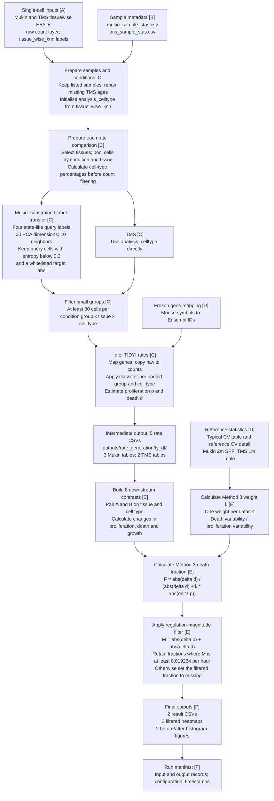

# Objective 3: Death–proliferation dominance

This analysis estimates the relative contribution of changes in cell death to
changes in proliferation and death across conditions in the Mukin and TMS
datasets. The formal entry point is
[master_death_proliferation_dominance.py](master_death_proliferation_dominance.py).
By default, it generates five TIDYI rate tables from single-cell inputs, builds
eight downstream contrasts, and exports Method 3 results after a
regulation-magnitude filter.

This document describes the current implementation, reviewed on 2026-10-19.
Dataset definitions and annotation background are reserved for the project
owner in Section 2. Creating this document did not rerun the analysis.

## 1. Workflow

The labels [A]–[F] connect the diagram to the source index in Section 8.
The diagram uses Mermaid and can be viewed in a Markdown viewer with Mermaid
support.



## 2. Data definitions


### 2.1 `tissue_wise_knn`

**Processed h5ad data** : After QC, ASTRID reannotation, tissue wise knn dying cell label transfer
### 2.2 `mukin_sample_stas.csv`

**selected high quality samples after qc and batch effect filteration** 
### 2.3 `tms_sample_stas.csv`

**selected high quality samples after qc and batch effect filteration** 

## 3. Inputs and directory roles

Paths in this document are relative to this directory unless written as
absolute paths. Large H5ADs remain at their existing external locations.

| Input | Location | Role in the current code |
|---|---|---|
| Mukin single-cell matrix | [mukin_data_tissuewise_knn.h5ad](/scratch/chenxi.sun/thesis_project/mukin_qcdata/mukin_data_tissuewise_knn.h5ad) | Expression and cell metadata, including the base annotation |
| TMS single-cell matrix | [tms_10x_tissuewise_knn.h5ad](/scratch/chenxi.sun/thesis_project/tms_qcdata/tms_10x_tissuewise_knn.h5ad) | Expression and cell metadata, including the base annotation |
| Mukin sample table | [rate_generation_inputs/mukin_sample_stas.csv](rate_generation_inputs/mukin_sample_stas.csv) | Sample inclusion list; grouping uses the H5AD metadata |
| TMS sample table | [rate_generation_inputs/tms_sample_stas.csv](rate_generation_inputs/tms_sample_stas.csv) | Sample inclusion list; supplies sample-to-mouse mapping when needed |
| Frozen gene mapping | [mouse_symbol_to_ensembl.csv](../inputs/gene_mapping/mouse_symbol_to_ensembl.csv) | Offline mouse symbol-to-Ensembl conversion |
| Typical CV values | [stats_notebook_aging_typical_cv_values.csv](../inputs/tidyi_statistics/stats_notebook_aging_typical_cv_values.csv) | Dataset-specific reference CVs and their source identifiers |
| Reference CV detail | [stats_notebook_ref_cv_separate_by_dataset_celltype.csv](../inputs/tidyi_statistics/stats_notebook_ref_cv_separate_by_dataset_celltype.csv) | Reference mean rates used to calculate Method 3 weights |

The sample tables were copied from
`/scratch/chenxi.sun/thesis_project/TIDYI/TIDYI_pattern/`; see the
[input provenance notes](rate_generation_inputs/README.md).

Directory roles:

- `support/`: rate-generation implementation called by the master.
- `rate_generation_inputs/`: saved sample tables and their provenance notes.
- `outputs/`: generated rates, final results, and run manifest; reruns overwrite
  the corresponding output paths.
- `reference_outputs/`: historical comparison results, preserved separately
  from generated outputs. The master does not overwrite these files.

## 4. Processing and analysis units

### Sample preparation and pooled rates

The rate producer retains samples listed in the saved sample tables, derives
the TMS age groups, and repairs missing TMS ages using mouse-level information.
It initializes `analysis_celltype` from `tissue_wise_knn`.

Within each selected rate comparison, cells from the same condition and tissue
are pooled across samples. One inferred rate row therefore represents a
**condition group × tissue × fine cell type**, rather than an individual mouse.
The downstream unit is a **tissue × cell type × condition contrast**.

| Dataset | Young | Old | Tissues for rate generation | Tissues for final contribution analysis |
|---|---|---|---|---|
| Mukin | 2m | 19m | Bone-marrow, Epidermis-E, Spleen | Marrow, Epi-e, Spleen |
| TMS | 1m and 3m pooled | 21m and 24m pooled | Marrow, Spleen, Tongue | Marrow, Spleen |

Mukin tissue names are normalized in the exported rate tables.

### Annotation transfer, percentages, and filtering

For Mukin only, the following query labels undergo comparison-specific
constrained kNN transfer: `HF Quiescennt cell`, `Proliferative B cell`,
`Proliferative Tcell`, and `Proliferating KC`. Spelling is preserved from the
code. Transfer uses 30 PCA dimensions and 10 neighbors. A query cell is retained
only if normalized entropy is strictly below 0.3 and its predicted target is in
the query label's whitelist. Other reference cells remain in the analysis.
TMS does not receive this additional transfer/filter step.

Cell-type percentages are calculated within each pooled condition group and
tissue before the 80-cell filter. For Mukin, the percentages are calculated
before relabeling; the producer redistributes query-label percentage components
among retained target assignments. The exported `percentage` is metadata and
does not enter the downstream Method 3 formula.

After transfer, each condition group is filtered separately: a tissue–cell-type
group must contain at least 80 cells. Rate inference uses the fine
`analysis_celltype` labels. The later `celltye_cross-tissue` aggregation is not
used for Objective 3 rates. This workflow does not establish that the labels
were manually reviewed through ASTRID.

### Gene conversion and TIDYI

The producer uses the shared frozen mapping through
[gene_mapping.py](../gene_mapping.py), retains unresolved gene names, and makes
duplicate mapped names unique without merging expression counts. It copies
the `raw` layer to `counts`, trains the TIDYI classifier, and applies it to each
pooled group and cell type. The output includes `prolif_rate`, `death_rate`,
derived `growth_rate` and `turn_over`, percentages, and grouping metadata.

See the [mapping policy](../inputs/gene_mapping/README.md) for conversion rules.
Its older statement that Objective 3 normally consumes saved rates is outdated;
the current master regenerates rates by default.

## 5. Five rate tables and eight downstream contrasts

All five generated rate tables are written under `outputs/rate_generation/ty_df/`.
The identifiers below become filenames by appending `_tidyi.csv`.

| Key | Rate-table identifier | Conditions estimated |
|---|---|---|
| M1 | `mukin_young_spf_vs_old_spf` | Young SPF, Old SPF |
| M2 | `mukin_young_spf_vs_young_gf` | Young SPF, Young GF |
| M3 | `mukin_old_spf_vs_old_gf` | Old SPF, Old GF |
| T1 | `tms_young_male_vs_young_female` | Young male, Young female |
| T2 | `tms_old_male_vs_old_female` | Old male, Old female |

The master takes the following condition-specific rates from those tables.
The keys are table references, not Method numbers. All differences use **A − B**.

| Dataset | Condition A | Condition B | Source for A / B |
|---|---|---|---|
| Mukin | Young GF | Young SPF | M2 / M2 |
| Mukin | Old SPF | Young SPF | M1 / M1 |
| Mukin | Old GF | Young GF | M3 / M2 |
| Mukin | Old GF | Old SPF | M3 / M3 |
| TMS | Young female | Young male | T1 / T1 |
| TMS | Old male | Young male | T2 / T1 |
| TMS | Old female | Young female | T2 / T1 |
| TMS | Old female | Old male | T2 / T2 |

Pairs are inner-joined on `tissue` and `celltype`, with one-to-one validation.
Only tissue–cell-type combinations present on both sides enter a contrast.
Thus, missing combinations are not treated as zero rates. Mukin relabeling is
comparison-specific, so a condition's rate must be traced to the table selected
above rather than substituted from another comparison.

## 6. Method 3 and the regulation-magnitude filter

Let `p` be proliferation rate and `d` death rate, both in h⁻¹:

```text
delta_p      = p_A - p_B
delta_d      = d_A - d_B
delta_growth = delta_p - delta_d

k = (CV_death,ref * mean_death,ref) /
    (CV_prolif,ref * mean_prolif,ref)

death_fraction_m3 = abs(delta_d) /
                   (abs(delta_d) + k * abs(delta_p))
```

Each dataset has one `k`. The typical-CV table selects the reference sources:
Mukin 2m SPF and TMS 1m male. For each rate, the reference mean is the arithmetic
mean of `mean_rate` over the corresponding reference-detail rows with
`cv_status == 'computed'`. The current saved inputs give approximately
`k = 1.963771` for Mukin and `k = 1.930233` for TMS; different reference inputs
require recalculation.

Method 3 expresses relative changes after adjustment for reference variability.
Values nearer 1 indicate a larger death contribution on this scale; values
nearer 0 indicate a larger proliferation contribution. It is not a literal
percentage of net growth change. A zero denominator produces a missing fraction.

The separate magnitude filter is:

```text
regulation_magnitude = abs(delta_p) + abs(delta_d)
threshold            = 2 * ln(2) / (24 * 3)
                     = 0.01925408835 h^-1
passes_filter        = regulation_magnitude >= threshold
```

The same threshold applies to both datasets. The original fraction and the row
are retained in the CSV; the filtered fraction is set to missing when the
threshold is not met. This filter uses the sum of absolute changes, not absolute
net growth change, and is not a significance test.

The historical notebook calls this the "Regulation-magnitude filter proposed
by Jean." Its formula equals twice the growth rate corresponding to a 3-day
doubling time. That notebook does not document why three days or the factor of
two were selected; no additional rationale is assumed here.

## 7. Outputs and running the analysis

For each prefix `mukin` and `tms`, the master writes these files under `outputs/`:

| Filename pattern | Contents |
|---|---|
| `{prefix}_regulation_magnitude_filter.csv` | Contrast identifiers, signed rate changes, absolute changes, magnitude, threshold, pass flag, and original/filtered Method 3 fractions |
| `{prefix}_method3_magnitude_filtered_heatmap.png` | Tissue–cell-type rows by four contrasts; retained fractions in color, filtered available fractions in white, unavailable fractions in gray |
| `{prefix}_method3_magnitude_filter_histograms.png` | Before/after fraction distributions using 5-bin and 10-bin histograms |

The master also writes
`outputs/master_death_proliferation_dominance_run_manifest.json`, recording run
mode, timestamps, TIDYI labels/source-root argument, configuration, and file
records. File records include checksums for files at or below 100 MB; the large
H5AD records are not full checksum verification. Version/model/formula labels
are supplied annotations, not automatic verification of the imported TIDYI code.
The existing `outputs/master_death_proliferation_dominance_full_run.log` is
historical execution evidence; the master does not automatically create that
log filename on every run.

Read the [package handover guide](../RA_PROJECT_HANDOVER_GUIDE.md) first and use
a Python environment containing TIDYI and the dependencies imported by the master
and producer. Run the master rather than invoking the support script directly.
The following commands assume the current directory is `03_death_proliferation/`.

```bash
# Full analysis: single cells -> five rate tables -> six final result files.
python master_death_proliferation_dominance.py

# Full analysis using a replacement checkout containing the tidyi package.
python master_death_proliferation_dominance.py \
  --tidyi-source-root /path/containing/tidyi \
  --tidyi-version-label VERSION_OR_COMMIT \
  --tidyi-model-label MODEL_NAME \
  --tidyi-formula-label FORMULA_NAME

# Downstream analysis only, using the five previously generated rate tables.
python master_death_proliferation_dominance.py \
  --use-precomputed-rates \
  --tidyi-input-root outputs/rate_generation/ty_df
```

The default precomputed fallback, when no `--tidyi-input-root` is provided, is
`../inputs/tidyi_refine/`. Such a run does not regenerate or test the upstream
TIDYI rates. Alternative H5AD paths can be supplied with `--mukin-h5ad` and
`--tms-h5ad` in full-run mode.

For handover review, confirm the five rate tables and six final result files,
inspect the manifest's run mode and actual input paths, and review the figures
and filtering behavior against `reference_outputs/`. Differences require
checking input, annotation, gene-mapping, and TIDYI lineage. Successful output
checks establish technical completion; scientific and visual acceptance remain
manual. Historical scatter, effect-size, growth-noise-filter, and older
decomposition figures are outside this master's declared final outputs.

## 8. Source index

Current scripts establish implemented behavior. Historical notebooks and logs
explain lineage; they are not additional steps to run before the master.
Notebook cell numbers below are zero-based.

| Diagram label | Source | What it establishes |
|---|---|---|
| [A], [B] | [Rate-generation input README](rate_generation_inputs/README.md) | Authoritative H5AD paths and original sample-table locations |
| [C] | [Current rate producer](support/tidyi_comparison_analysis.py) | `COMPARISON_DEFINITIONS`, metadata preparation, relabeling, count filter, TIDYI calls, and exported rate columns |
| [C] | [TIDYI_analysis_spl-merge.ipynb](/scratch/chenxi.sun/thesis_project/TIDYI/TIDYI_pattern/TIDYI_analysis_spl-merge.ipynb) | Historical notebook underlying rate generation |
| [C] | [Historical producer](/scratch/chenxi.sun/thesis_project/TIDYI/TIDYI_pattern/ty_pipeline_scripts/tidyi_comparison_analysis.py) and [historical run log](/scratch/chenxi.sun/TIDYI_refine/logs/all_comparisons_refined.log) | Legacy implementation and execution evidence cited by the master |
| [D] | [Mapping module](../gene_mapping.py) and [mapping provenance](../inputs/gene_mapping/mapping_provenance.json) | Current offline conversion implementation and frozen mapping source |
| [D] | [Typical CV table](../inputs/tidyi_statistics/stats_notebook_aging_typical_cv_values.csv) and [reference CV detail](../inputs/tidyi_statistics/stats_notebook_ref_cv_separate_by_dataset_celltype.csv) | Exact saved inputs used for Method 3 calibration |
| [D] | [stats.ipynb](/scratch/chenxi.sun/TIDYI_statistics/stats.ipynb), cell 7 | Historical reference-CV calculation and export; the typical-CV table also records its summary-source path |
| [E] | [Current master](master_death_proliferation_dominance.py) | `CONTRASTS`, `build_paired_rates`, `calculate_method3`, `magnitude_table`, and `save_magnitude_outputs` |
| [E] | [cell_death_test.ipynb](</scratch/chenxi.sun/RA project/death matter/cell_death_test.ipynb>), cells 6, 11, and 12 | Historical Method 3 formula and Mukin/TMS magnitude filters |
| [F] | [Generated outputs](outputs/) and [run manifest](outputs/master_death_proliferation_dominance_run_manifest.json) | Results and recorded provenance of the saved run; these paths require a completed run |
| [F] | [Saved full-run log](outputs/master_death_proliferation_dominance_full_run.log) and [historical reference outputs](reference_outputs/) | Existing execution evidence and preserved comparison figures/tables |

After the project owner completes Section 2, review those definitions together
with the input provenance notes before treating the handover as complete.
