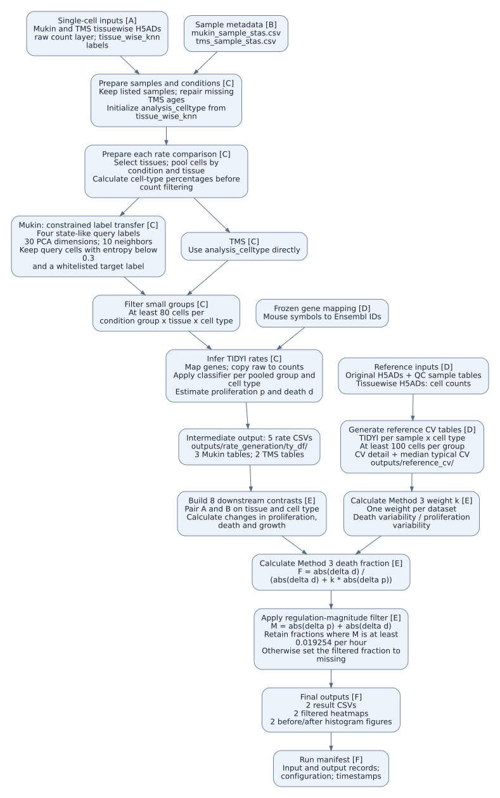

# Objective 3: Death–proliferation dominance

This analysis estimates the relative contribution of changes in cell death to
changes in proliferation and death across conditions in the Mukin and TMS
datasets. The formal entry point is
[master_death_proliferation_dominance.py](master_death_proliferation_dominance.py).
By default, it generates five pooled TIDYI rate tables and new sample-level
reference CV tables from H5AD inputs, builds eight downstream contrasts,
and exports Method 3 results after a
regulation-magnitude filter.

This document describes the current implementation, reviewed on 2026-10-19.
Creating this document did not rerun the analysis.

## 1. Workflow

The labels [A]–[F] connect the diagram to the source index in Section 7.
The embedded SVG displays without a Mermaid extension. Open the image to zoom.



## 2. Inputs and directory roles

Paths in this document are relative to this directory unless written as
absolute paths. Large H5ADs remain at their existing external locations.

| Input | Location | Data description |
|---|---|---|
| Mukin and TMS tissuewise matrices | [Mukin H5AD](../../thesis_project/mukin_qcdata/mukin_data_tissuewise_knn.h5ad)<br>[TMS H5AD](../../thesis_project/tms_qcdata/tms_10x_tissuewise_knn.h5ad) | Processed h5ad data: After QC, tissue wise knn dying cell label transfer, used for TIDYI inference |
| Original Mukin and TMS matrices | [Mukin H5AD](../../thesis_project/mukin_qcdata/mukin_data.h5ad)<br>[TMS H5AD](../../thesis_project/tms_qcdata/tms_10x.h5ad) | original data without modification |
| Mukin and TMS sample tables | [Mukin CSV](rate_generation_inputs/mukin_sample_stas.csv)<br>[TMS CSV](rate_generation_inputs/tms_sample_stas.csv) | samples passed QC and batch effect |
| Frozen gene mapping | [Mapping CSV](../inputs/gene_mapping/mouse_symbol_to_ensembl.csv) | Offline mouse symbol-to-Ensembl conversion |
| Generated typical CV values | [Typical CV CSV](outputs/reference_cv/stats_notebook_aging_typical_cv_values.csv) | Regenerated by full runs; reused by default in precomputed mode and by Objective 5 |
| Generated reference CV detail | [Reference CV CSV](outputs/reference_cv/stats_notebook_ref_cv_separate_by_dataset_celltype.csv) | Regenerated reference means and CVs; reused by default in precomputed mode |

Full runs generate the two CV tables above under `outputs/reference_cv/`
and use them for Method 3. Precomputed mode reuses the saved tables without
regenerating them. The former frozen CV copies in the shared inputs were removed.

The sample tables were copied from
`/scratch/chenxi.sun/thesis_project/TIDYI/TIDYI_pattern/`; see the
[input provenance notes](rate_generation_inputs/README.md).

Directory roles:

- `support/`: two producers called directly by the master: pooled rates and reference CVs.
- `rate_generation_inputs/`: saved sample tables and their provenance notes.
- `outputs/`: generated rates, final results, and run manifest; reruns overwrite
  the corresponding output paths.
- `reference_outputs/`: historical comparison results, preserved separately
  from generated outputs. The master does not overwrite these files.

## 3. Processing and analysis units

### Sample preparation and pooled rates

The rate producer retains samples listed in the saved sample tables, derives
the TMS age groups, and repairs missing TMS ages using mouse-level information.
It initializes `analysis_celltype` from `tissue_wise_knn`.

Within each selected rate comparison, cells from the same condition and tissue
are pooled across samples. One inferred rate row therefore represents a
**condition group × tissue × fine cell type**, rather than an individual mouse.
The downstream unit is a **tissue × cell type × condition contrast**.

| Dataset | Young | Old | Tissues for rate generation | Tissues for final contribution analysis |
|---|---|---|---|---|
| Mukin | 2m | 19m | Bone-marrow, Epidermis-E, Spleen | Marrow, Epi-e, Spleen |
| TMS | 1m and 3m pooled | 21m and 24m pooled | Marrow, Spleen, Tongue | Marrow, Spleen |

Mukin tissue names are normalized in the exported rate tables.

### Annotation transfer, percentages, and filtering

For Mukin only, the following query labels undergo comparison-specific
constrained kNN transfer: `HF Quiescennt cell`, `Proliferative B cell`,
`Proliferative Tcell`, and `Proliferating KC`. Spelling is preserved from the
code. Transfer uses 30 PCA dimensions and 10 neighbors. A query cell is retained
only if normalized entropy is strictly below 0.3 and its predicted target is in
the query label's whitelist. Other reference cells remain in the analysis.
TMS does not receive this additional transfer/filter step.

Cell-type percentages are calculated within each pooled condition group and
tissue before the 80-cell filter. For Mukin, the percentages are calculated
before relabeling; the producer redistributes query-label percentage components
among retained target assignments. The exported `percentage` is metadata and
does not enter the downstream Method 3 formula.

After transfer, each condition group is filtered separately: a tissue–cell-type
group must contain at least 80 cells. Rate inference uses the fine
`analysis_celltype` labels. The later `celltye_cross-tissue` aggregation is not
used for Objective 3 rates. This workflow does not establish that the labels
were manually reviewed through ASTRID.

### Gene conversion and TIDYI

The producer uses the shared frozen mapping through
[gene_mapping.py](../gene_mapping.py), retains unresolved gene names, and makes
duplicate mapped names unique without merging expression counts. It copies
the `raw` layer to `counts`, trains the TIDYI classifier, and applies it to each
pooled group and cell type. The output includes `prolif_rate`, `death_rate`,
derived `growth_rate` and `turn_over`, percentages, and grouping metadata.

See the [mapping policy](../inputs/gene_mapping/README.md) for conversion rules.
Its older statement that Objective 3 normally consumes saved rates is outdated;
the current master regenerates rates by default.

### Sample-level reference calibration

[reference_cv_generation.py](support/reference_cv_generation.py) is a separate
producer called directly by the master. It does not call the pooled-rate
producer or execute a historical notebook.

1. Select Mukin 2m SPF and TMS 1m male samples from the saved QC sample tables.
2. Read the original H5ADs, use `live-dead_annotation`, and apply the label
   mappings from the historical sample-level `TIDYI_analysis.ipynb`.
3. Keep sample–cell-type groups containing at least 100 cells. This cutoff
   reconstructs the complete saved group sets: 68 Mukin and 455 TMS rate rows
   across their original cohorts. The notebook currently contains a default
   of 10; blindly copying that default would not reproduce those saved sets.
4. Infer proliferation/death rates for each reference sample and cell type,
   using `raw`, the frozen gene mapping, and the TIDYI implementation selected
   by the master. Both producers reset the NumPy random seed to 0 before each
   classifier training call. This explicit seed was added with the CV producer;
   earlier pooled runs did not set it here.
5. Independently count cells in the tissuewise H5ADs using the historical
   `tissue_wise_knn` mapping and reference age/model/sex masks. Preserve the old
   rule that excludes missing ages at this counting step; do not apply the
   pooled producer's age-repair or comparison-specific relabeling here.
6. Match count keys to reference rate keys, record unmatched groups, calculate
   sample SD (`ddof=1`) / absolute mean for groups with at least two finite
   observed rates and absolute mean above `1e-9`, then take the median valid CV
   across cell types. Missing rates are not replaced by zero.

This preserves the legacy grouping by reference dataset and cell type across
the available tissues. `Sample/sample` is the replicate key, not automatically
an independent animal. Tissue composition, annotation differences, and small
replicate counts can therefore influence this variability estimate; it should
not be described as pure technical noise. Reference and pooled annotations
deliberately follow their respective historical workflows.

The new producer writes sample rates, CV detail, typical CVs, exclusions, and a
manifest to `outputs/reference_cv/`. The manifest records actual TIDYI module
path/checksum, interpreter, version labels, input records, maps, seed, and
statistical rules. The complete pipeline was run on 2026-10-19 using the active
TIDYI 0.1.0 environment. The [validation report](outputs/reference_cv_validation.json)
records the old-table replay, regenerated-rate/CV comparisons, file checksums,
and final filtering checks. Legacy replay agrees to floating-point precision.
Regenerated CVs and fractions have small numerical differences, while all
final filter decisions are unchanged (24 retained Mukin entries and 21 TMS).
Current formal outputs, the historical validation report, and `reference_outputs/`
are retained. The old CV copies used in that historical comparison are no longer
bundled; downstream reruns now default to the generated CV tables.

## 4. Five rate tables and eight downstream contrasts

All five generated rate tables are written under `outputs/rate_generation/ty_df/`.

These files are calculated from the H5ADs when the master calls
`generate_rate_tables()`, which launches
`support/tidyi_comparison_analysis.py` with `--output-dir outputs/rate_generation`.
They are generated intermediate results, not copied reference inputs. The
saved run manifest records `rate_source_mode: generated_from_single_cell`;
the retained tables match its recorded checksums.

The producer writes each result twice: once to `ty_df/` and once to
`<comparison>/tidyi/`. The master reads only the five tables in `ty_df/`.
The five byte-identical per-comparison copies were removed during cleanup;
rerunning the current producer will recreate them. Keep `ty_df/` for downstream
reruns and rate provenance. The final results, run manifest, full-run log, and
`reference_outputs/` are retained separately.

The identifiers below become filenames by appending `_tidyi.csv`.

| Key | Rate-table identifier | Conditions estimated |
|---|---|---|
| M1 | `mukin_young_spf_vs_old_spf` | Young SPF, Old SPF |
| M2 | `mukin_young_spf_vs_young_gf` | Young SPF, Young GF |
| M3 | `mukin_old_spf_vs_old_gf` | Old SPF, Old GF |
| T1 | `tms_young_male_vs_young_female` | Young male, Young female |
| T2 | `tms_old_male_vs_old_female` | Old male, Old female |

The master takes the following condition-specific rates from those tables.
The keys are table references, not Method numbers. All differences use **A − B**.

| Dataset | Condition A | Condition B | Source for A / B |
|---|---|---|---|
| Mukin | Young GF | Young SPF | M2 / M2 |
| Mukin | Old SPF | Young SPF | M1 / M1 |
| Mukin | Old GF | Young GF | M3 / M2 |
| Mukin | Old GF | Old SPF | M3 / M3 |
| TMS | Young female | Young male | T1 / T1 |
| TMS | Old male | Young male | T2 / T1 |
| TMS | Old female | Young female | T2 / T1 |
| TMS | Old female | Old male | T2 / T2 |

Pairs are inner-joined on `tissue` and `celltype`, with one-to-one validation.
Only tissue–cell-type combinations present on both sides enter a contrast.
Thus, missing combinations are not treated as zero rates. Mukin relabeling is
comparison-specific, so a condition's rate must be traced to the table selected
above rather than substituted from another comparison.

## 5. Method 3 and the regulation-magnitude filter

Let $p$ be proliferation rate and $d$ death rate, both in h⁻¹:

$$
\begin{aligned}
\Delta p &= p_A - p_B, \\
\Delta d &= d_A - d_B, \\
\Delta g &= \Delta p - \Delta d.
\end{aligned}
$$

Here $\Delta g$ is `delta_growth` in the code.

$$
k = \frac{\mathrm{CV}_{d,\mathrm{ref}}\,\bar{d}_{\mathrm{ref}}}
         {\mathrm{CV}_{p,\mathrm{ref}}\,\bar{p}_{\mathrm{ref}}}
$$

$$
F_{\mathrm{death}}^{(3)}
= \frac{|\Delta d|}{|\Delta d| + k\,|\Delta p|}
$$

$F_{\mathrm{death}}^{(3)}$ corresponds to `death_fraction_m3` in the code.

Each dataset has one `k`. The generated typical-CV table selects the reference sources:
Mukin 2m SPF and TMS 1m male. For each rate, the reference mean is the arithmetic
mean of `mean_rate` over the corresponding reference-detail rows with
`cv_status == 'computed'`. The historical frozen inputs gave approximately
`k = 1.963771` for Mukin and `k = 1.930233` for TMS. Full runs recompute both
the CVs and reference means; those legacy weights are not assumed for a new run.

Method 3 expresses relative changes after adjustment for reference variability.
Values nearer 1 indicate a larger death contribution on this scale; values
nearer 0 indicate a larger proliferation contribution. It is not a literal
percentage of net growth change. A zero denominator produces a missing fraction.

The separate magnitude filter is:

$$
M = |\Delta p| + |\Delta d|
$$

$$
\tau = \frac{2\ln(2)}{24\times 3}
     \approx 0.01925408835\;\mathrm{h}^{-1}
$$

$$
\text{Pass the filter if}\quad M \geq \tau.
$$

$M$ is `regulation_magnitude`; $\tau$ is `regulation_threshold` in the CSV.

The same threshold applies to both datasets. The original fraction and the row
are retained in the CSV; the filtered fraction is set to missing when the
threshold is not met. This filter uses the sum of absolute changes, not absolute
net growth change, and is not a significance test.

The historical notebook calls this the "Regulation-magnitude filter proposed
by Jean." Its formula equals twice the growth rate corresponding to a 3-day
doubling time. That notebook does not document why three days or the factor of
two were selected; no additional rationale is assumed here.

## 6. Outputs and running the analysis

For each prefix `mukin` and `tms`, the master writes these files under `outputs/`:

| Filename pattern | Contents |
|---|---|
| `{prefix}_regulation_magnitude_filter.csv` | Contrast identifiers, signed rate changes, absolute changes, magnitude, threshold, pass flag, and original/filtered Method 3 fractions |
| `{prefix}_method3_magnitude_filtered_heatmap.png` | Tissue–cell-type rows by four contrasts; retained fractions in color, filtered available fractions in white, unavailable fractions in gray |
| `{prefix}_method3_magnitude_filter_histograms.png` | Before/after fraction distributions using 5-bin and 10-bin histograms |

Full runs also create the following under `outputs/reference_cv/`:

| Filename | Contents |
|---|---|
| `reference_sample_rates.csv` | New TIDYI rates and rate-cell counts per reference sample and cell type |
| `stats_notebook_ref_cv_separate_by_dataset_celltype.csv` | Reference means, sample SDs, CVs, sample counts, and computation status |
| `stats_notebook_aging_typical_cv_values.csv` | Four median-CV rows used by Method 3, with reference means and valid cell-type counts |
| `reference_cv_exclusions.csv` | Groups below the reference cell-count cutoff and rates without matching tissuewise count keys |
| `reference_cv_run_manifest.json` | Actual TIDYI module record, inputs, configuration, and generated-file records |

The master also writes
`outputs/master_death_proliferation_dominance_run_manifest.json`, recording run
mode, timestamps, TIDYI labels/source-root argument, configuration, and file
records. File records include checksums for files at or below 100 MB; the large
H5AD records are not full checksum verification. Version/model/formula labels
are supplied annotations, not automatic verification of the imported TIDYI code.
The retained `outputs/master_death_proliferation_dominance_full_run.log`
captures the latest complete run. The master does not automatically create
that log filename on every invocation; it was captured by the execution wrapper.

Read the [package handover guide](../RA_PROJECT_HANDOVER_GUIDE.md) first and use
a Python environment containing TIDYI and the dependencies imported by the master
and producer. Run the master rather than invoking the support script directly.
The following commands assume the current directory is `03_death_proliferation/`.

```bash
# Full analysis: H5ADs -> pooled rates and reference CVs -> six final result files.
python master_death_proliferation_dominance.py

# Full analysis using a replacement checkout containing the tidyi package.
python master_death_proliferation_dominance.py \
  --tidyi-source-root /path/containing/tidyi \
  --tidyi-version-label VERSION_OR_COMMIT \
  --tidyi-model-label MODEL_NAME \
  --tidyi-formula-label FORMULA_NAME

# Downstream analysis only, using matching generated rates and reference CVs.
python master_death_proliferation_dominance.py \
  --use-precomputed-rates \
  --tidyi-input-root outputs/rate_generation/ty_df \
  --reference-cv-root outputs/reference_cv
```

The default precomputed fallback, when no `--tidyi-input-root` is provided, is
`../inputs/tidyi_refine/`. Without `--reference-cv-root`, compatibility mode
uses saved generated CVs in `outputs/reference_cv/`. Thus the default
compatibility combination is the historical rate set plus the latest saved
generated CVs. It skips both producers; use `--tidyi-input-root` and
`--reference-cv-root` to select a specific matching rate/CV pair. `--reference-cv-root`
is rejected outside compatibility mode; a normal full run always recomputes CVs.

Alternative tissuewise H5ADs can be supplied with `--mukin-h5ad` and
`--tms-h5ad`. Alternative original reference-rate H5ADs can be supplied with
`--mukin-reference-h5ad` and `--tms-reference-h5ad`. Both pairs must represent
the intended datasets and annotations. All four inputs remain outside the repository.

For handover review, confirm the five pooled rate tables, five reference-CV
output/provenance files, and six final result files,
inspect the manifest's run mode and actual input paths, and review the figures
and filtering behavior against `reference_outputs/`. Differences require
checking input, annotation, gene-mapping, and TIDYI lineage. Successful output
checks establish technical completion; scientific and visual acceptance remain
manual. Historical scatter, effect-size, growth-noise-filter, and older
decomposition figures are outside this master's declared final outputs.

## 7. Source index

### 7.1 Current runtime dependencies and reading order

Start with the current master and the two local producers. The historical
scripts and notebooks in Section 7.2 are provenance references; the master
neither executes nor imports them.

The full-run execution path is:

```text
master_death_proliferation_dominance.py
  main()
    generate_rate_tables()
      launches support/tidyi_comparison_analysis.py in a subprocess
        main() -> run_single_comparison() -> run_tidyi_analysis()
          imports the TIDYI package and applies its classifier
    generate_reference_cv_tables()
      launches support/reference_cv_generation.py in a subprocess
        infers sample rates -> matches tissuewise counts -> writes reference CV tables
    load_rate_tables() -> build_paired_rates()
    calculate_method3() -> magnitude_table() -> save_magnitude_outputs()
    writes the run manifest
```

The master directly calls two sibling producer scripts; neither calls the other.
Both use the same external TIDYI package. Method 3, magnitude filtering, and final plotting are
implemented directly in the master. In `--use-precomputed-rates` mode, both
producers and TIDYI inference are skipped.

| Read in this order | Current file | Responsibility |
|---|---|---|
| 1 | [Master](master_death_proliferation_dominance.py) | Start at `main()`; inspect `CONTRASTS`, then pairing, Method 3, filtering, and plotting functions |
| 2 | [Local rate producer](support/tidyi_comparison_analysis.py) | Start at `main()` and `run_single_comparison()` for sample preparation, label transfer, count filtering, and TIDYI inference |
| 3 | [Reference CV producer](support/reference_cv_generation.py) | Sample-level reference rates, historical count matching, CV aggregation, and calibration provenance |
| 4, when needed | [gene_mapping.py](../gene_mapping.py) | Shared offline gene conversion used by both producers |
| 4, when needed | [handover_utils.py](../handover_utils.py) | Shared path checks, TIDYI source configuration, file records, and output checks used by this master; its notebook-execution helpers are not called by Objective 3 |

`RATE_PRODUCER` points to `03_death_proliferation/support/`, not to the historical
`thesis_project/.../ty_pipeline_scripts/` copy. TIDYI is imported from the active
Python environment unless `--tidyi-source-root` explicitly selects a replacement.
The `legacy_rate_producer` and `legacy_rate_log` entries written into the run
manifest are provenance strings, not files loaded or executed by the master.

The current inputs and implementation references are:

| Diagram label | Source | What it establishes |
|---|---|---|
| [A], [B] | [Rate-generation input README](rate_generation_inputs/README.md) | Authoritative H5AD paths and original sample-table locations |
| [C] | [Current rate producer](support/tidyi_comparison_analysis.py) | `COMPARISON_DEFINITIONS`, metadata preparation, relabeling, count filter, TIDYI calls, and exported rate columns |
| [D] | [Current reference CV producer](support/reference_cv_generation.py) | Generates the reference CV and mean-rate tables from original and tissuewise H5ADs |
| [D] | [Mapping module](../gene_mapping.py) and [mapping provenance](../inputs/gene_mapping/mapping_provenance.json) | Current offline conversion implementation and frozen mapping source |
| [D] | [Generated typical CV table](outputs/reference_cv/stats_notebook_aging_typical_cv_values.csv) and [generated reference CV detail](outputs/reference_cv/stats_notebook_ref_cv_separate_by_dataset_celltype.csv) | Full-run outputs; default saved CV inputs for compatibility runs |
| [E] | [Current master](master_death_proliferation_dominance.py) | `CONTRASTS`, `build_paired_rates`, `calculate_method3`, `magnitude_table`, and `save_magnitude_outputs` |

Normal runs use the new support script to generate their CV CSVs; historical
notebooks are never executed. The H5ADs outside the repository are actual data
inputs; see Section 2. Their external location does not imply execution of old
analysis scripts. The input README and mapping-provenance JSON document the
inputs; the analysis reads the H5ADs/CSVs and mapping table themselves.

### 7.2 Historical references only — not executed by the master

Read these files to investigate how a method or saved input originated. They
are not required reading for following the current execution path. Notebook
cell numbers below are zero-based.

| Diagram label | Source | What it establishes |
|---|---|---|
| [C] | [TIDYI_analysis_spl-merge.ipynb](../../thesis_project/TIDYI/TIDYI_pattern/TIDYI_analysis_spl-merge.ipynb) | TIDYI analysis based on pooled sample for mukin and tms to get more cell types past cell numbers threshold    |
| [C] | [Historical producer](../../thesis_project/TIDYI/TIDYI_pattern/ty_pipeline_scripts/tidyi_comparison_analysis.py) and [historical run log](../../TIDYI_refine/logs/all_comparisons_refined.log) | Legacy implementation and execution evidence cited by the master |
| [D] | [TIDYI_analysis.ipynb](../../thesis_project/TIDYI/TIDYI_pattern/TIDYI_analysis.ipynb), cells 13-15, 33, 36-41 | Original sample-rate annotations, rate inference, and sample metadata joins; its saved filter default does not reproduce the saved rate-group sets |
| [D] | [ty_mukin_norm.csv](../../thesis_project/TIDYI/TIDYI_pattern/ty_mukin_norm.csv) and [tms_ty_df.csv](../../thesis_project/TIDYI/TIDYI_pattern/tms_ty_df.csv) | Historical sample-rate group sets used to establish the 100-cell cutoff; these saved rates are not inputs to the new CV producer |
| [D] | [stats.ipynb](../../TIDYI_statistics/stats.ipynb), cell 7 | Historical reference-CV calculation and export; the typical-CV table also records its summary-source path |
| [E] | [cell_death_test.ipynb](../../RA%20project/death%20matter/cell_death_test.ipynb), cells 6, 11, and 12 | Historical Method 3 formula and Mukin/TMS magnitude filters |

### 7.3 Results and execution evidence — not analysis code

| Diagram label | Source | What it establishes |
|---|---|---|
| [F] | [Generated outputs](outputs/) and [run manifest](outputs/master_death_proliferation_dominance_run_manifest.json) | Results and recorded provenance of the saved run; these paths require a completed run |
| [F] | [Saved full-run log](outputs/master_death_proliferation_dominance_full_run.log) and [historical reference outputs](reference_outputs/) | Existing execution evidence and preserved comparison figures/tables |

All links are relative to this README. Historical notebooks, the historical
producer, and the historical log are outside this repository; their links
require the existing sibling directories under `/scratch/chenxi.sun`.
Generated-output links point to local run results, which are not versioned in Git.
