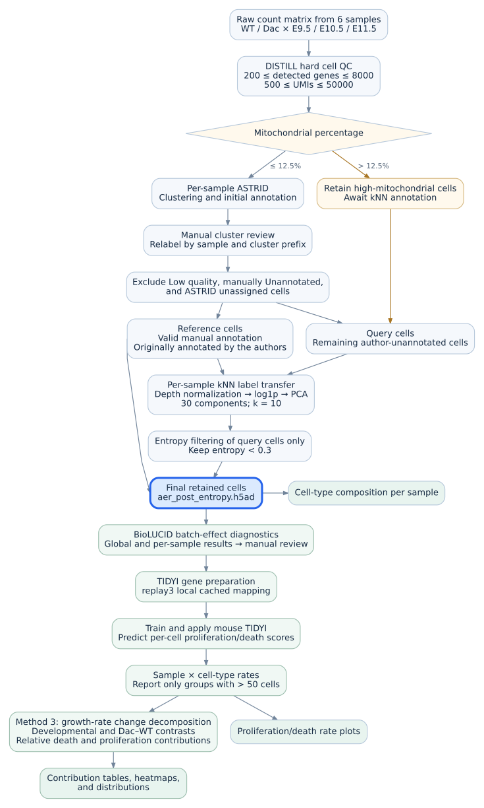

# Objective 5: AER developmental validation

This analysis estimates proliferation and death rates in six embryonic mouse
samples: WT and Dac at E9.5, E10.5, and E11.5. The formal entry point is
[master_aer_developmental_validation.py](master_aer_developmental_validation.py).
It resumes from the retained, annotated post-entropy H5AD, runs BioLUCID and
mouse TIDYI, compares seven developmental/genotype contrasts with Method 3,
and exports the retained figures and tables.

This document follows the structure of the [Objective 3 guide](../03_death_proliferation/README.md)
and describes the implementation reviewed on **2026-10-20**. Documentation and
static checks do not constitute a new scientific run. All notebook cell
numbers below are **one-based**, matching `SELECTED_CELLS` in the master.

## 1. Workflow and execution boundary

The English, top-to-bottom diagram follows the full AER processing workflow,
including the annotation branches and downstream outputs. The editable
[Mermaid source](docs/workflow.mmd) is stored beside the SVG.

**The current master starts at the highlighted `aer_post_entropy.h5ad` node.**
The preceding nodes describe the checkpoint's upstream provenance. Running
the master does not rerun Cell Ranger, raw-count reconstruction, QC, ASTRID,
manual annotation, kNN transfer, or entropy filtering.

The notebook describes manual BioLUCID review before TIDYI. The master enables
both stages and runs them consecutively: the message saying to stop after
BioLUCID is informational, not an execution pause. For a new annotation or
dataset, review the diagnostics before accepting downstream conclusions.

## 2. Inputs and directory roles

Links are relative to this README. The two H5AD links point outside the
repository to `/srv/mfs/hausserlab/data/AER2025_Juliane/` on the shared server.
Keep large H5ADs at their documented external locations.

| Input | File | Role |
|---|---|---|
| Raw-count reconstruction | [Raw counts H5AD](../../../../srv/mfs/hausserlab/data/AER2025_Juliane/aer_six_samples_raw_counts.h5ad) | Required path checked by the master; produced by the historical Scanpy reconstruction. The downstream analysis loads the post-entropy object instead. |
| Post-entropy checkpoint | [Post-entropy H5AD](../../../../srv/mfs/hausserlab/data/AER2025_Juliane/aer_post_entropy.h5ad) | Actual cell/count/annotation input for BioLUCID and TIDYI; upstream review is already represented in this checkpoint. |
| Frozen mouse mapping | [Mapping CSV](../inputs/gene_mapping/mouse_symbol_to_ensembl.csv) | Shared replay3 archived-cache mapping, applied by [gene_mapping.py](../gene_mapping.py). |
| Typical reference CVs | [Typical CV CSV](../inputs/tidyi_statistics/stats_notebook_aging_typical_cv_values.csv) | Method 3 selects the two `dataset == "Mukin"` rows. These are frozen inputs, not automatically regenerated by Objective 3 when running AER. |
| Cell-type composition | [Composition TSV](inputs/distill_celltype_percentages_by_sample.tsv) | Historical final-cell composition used by `make_pub_ready_figures.py`; currently read as a saved input. |
| Marker reference | [Marker CSV](inputs/ExpectedCellTypesMarkersMouse.csv) | Bundled ASTRID marker reference. The master checks/copies its project configuration, although it does not run ASTRID. |
| Project marker configuration | [AER marker CSV](config/ExpectedCellTypesMarkersMouse_AER.csv) | Editable upstream ASTRID configuration; copied from the bundled reference only if absent. Existing edits are preserved. |

The post-entropy object's `obs` must contain `sample`, `genotype`, `stage`,
and complete `cell_type` values. It must retain raw integer counts in
`layers['counts']`, with `gene_ids` and `gene_symbol` in `var`.
`astrid_reannotation`, kNN roles, confidence, and entropy fields document the
upstream lineage; downstream grouping uses **`cell_type`**.

The composition TSV was copied from
`/scratch/chenxi.sun/AER_DISTILL/outputs/06_final/celltype_percentage_barplots/`.
Its 42 rows were checked against the retained post-entropy cell metadata on
2026-10-20: counts, sample denominators, and percentages agreed. The current
master still reads this saved TSV; it does not regenerate it. If the retained
cells or labels change, regenerate the composition table too. The producer is
`plot_celltype_percentages_by_sample()` in the helper module; it writes both a
table and a historical plot, so use a separate staging directory when invoking
it for a new checkpoint.

The former `knn_transfer_summary.csv`, `entropy_qc_by_sample.csv`, and
`entropy_qc_by_sample_celltype.csv` were copied upstream audit reports. They
are no longer required or displayed by the master. Historical copies are in
`archive/outputs/2026-10-20/04_restore_high_mito/`; this archive is local and
may be absent in a fresh clone. Those reports include rejected query cells,
so the full reports cannot be reconstructed from the post-entropy H5AD alone.

Directory roles:

- `inputs/`: the marker reference and saved composition table.
- `config/`: editable marker configuration for upstream annotation.
- `docs/`: the workflow SVG included in this README.
- `outputs/`: generated formal results, runtime provenance, and run manifest;
  running again overwrites the corresponding result paths.
- `reference_outputs/`: historical comparison results, preserved separately.
- `archive/`: retired intermediate reports; not read by the master.

Generated outputs, reference outputs, and the archive's nested `outputs/`
directories are ignored by the current Git configuration. A fresh clone needs
the H5ADs, the installed model/training data, and a separately supplied reference
bundle if historical comparison is required. Code and a README alone do not
include these data.

## 3. Processing and analysis units

### 3.1 Upstream annotation represented by the checkpoint

The notebook records this lineage:

1. Apply cell QC: 200–8,000 detected genes and 500–50,000 UMIs, inclusive.
   No genes are filtered at this step.
2. Send cells with mitochondrial percentage at most 12.5% to per-sample
   ASTRID. Keep higher-mitochondrial cells that pass hard QC for later transfer.
3. Review clusters using the explicit `ASTRID_REANNOTATION_PREFIXES` mapping
   in cell 15. Remove underscores from cluster paths; the longest matching
   prefix wins. The map is a saved manual decision, not automatic acceptance
   of ASTRID or SingleR labels.
4. Remove `Low quality`, manually `Unannotated`, and ASTRID-unassigned cells.
   Define query cells as the remaining original-author-unannotated cells plus
   high-mitochondrial cells; other cells with valid reviewed labels are references.
5. Within each sample, normalize to the reference median count depth, apply
   log1p, fit PCA on references, project queries, and transfer labels using
   Euclidean kNN with 30 components and 10 neighbors where data permit.
6. Filter query cells at normalized transfer entropy **strictly below 0.3**;
   retain reference cells. The helper divides each query's neighbor-label
   Shannon entropy by the Shannon entropy of the sample's reference-label
   proportions; it returns zero when that reference entropy is zero.
7. Save the retained, annotated `aer_post_entropy.h5ad`.

Changing `QC`, `TRANSFER`, `ENTROPY_THRESHOLD`, the marker configuration, or
the manual map does not change an existing checkpoint. These edits require
an upstream rebuild and review before they can affect the master.

### 3.2 BioLUCID

`preview_biolucid_groups()` reports the sample × cell-type input counts. Its
eligibility preview requires at least 20 cells of a cell type in every sample.
`run_biolucid()` passes the raw `counts` layer to BioLUCID with
`batch_key="sample"`, `celltype_key="cell_type"`, `min_cells=20`,
`abundant_gene_threshold=1`, and `min_abundant_genes=100`.

BioLUCID produces global and per-sample diagnostics. It does not automatically
remove cells, cell types, or samples, and it does not batch-correct the matrix
used for TIDYI. Review the diagnostic tables and plot scientifically.

### 3.3 Frozen gene mapping and mouse TIDYI

`prepare_mouse_tidyi()` preserves valid input ENSMUSG identifiers, consults the
shared local mapping for unresolved symbols, retains unresolved names such as
`Dac1J`, and makes duplicate mapped names unique without merging counts.
No online lookup or BioMart supplementation is performed by this adapter.
See the [mapping policy](../inputs/gene_mapping/README.md).

The adapter warns below 70% mapped genes and fails below 30% unless the existing
override is enabled. These are coverage checks; they do not authorize silently
discarding genes to improve the percentage.

`train_mouse_tidyi()` sets the NumPy seed to 0 and calls
`tidyi_main_mouse.tidy_rates_mouse(gene_list=...)` followed by
`train_classifier()`. The TIDYI package also requires its mouse classifier
training data, which are separate from the AER H5ADs and the frozen mapping.

Every retained cell receives division/death scores through whole-sample model
calls. Group rates are then estimated by applying the classifier separately
to eligible **sample × cell-type** subsets. They are model outputs for those
subsets, not arithmetic means of the per-cell scores. Groups must contain
**strictly more than 50 cells** to receive a rate row. This threshold does not
delete cells from the checkpoint or prevent their per-cell scores.

The master keeps scored objects in memory; it does not export a new scored
H5AD or rerun the notebook's final-export stage. Its formal rate columns are
`sample`, `genotype`, `stage`, `cell_type`, `n_cells`, `proliferation_rate`,
and `death_rate`. Rates are in h⁻¹.

## 4. Seven contrasts

Every contrast is **condition A minus condition B**, within a cell type.
There is one sample per genotype × stage in this dataset; this analysis does
not estimate within-condition replicate variability from AER itself.

| Contrast | Condition A | Condition B |
|---|---|---|
| WT E10.5 − E9.5 | WT E10.5 | WT E9.5 |
| WT E11.5 − E10.5 | WT E11.5 | WT E10.5 |
| Dac E10.5 − E9.5 | Dac E10.5 | Dac E9.5 |
| Dac E11.5 − E10.5 | Dac E11.5 | Dac E10.5 |
| E9.5 Dac − WT | Dac E9.5 | WT E9.5 |
| E10.5 Dac − WT | Dac E10.5 | WT E10.5 |
| E11.5 Dac − WT | Dac E11.5 | WT E11.5 |

Missing rate groups are not filled with zero. The output retains contrast
rows with an unavailable fraction and a reason indicating the missing side.

## 5. Method 3 and the magnitude filter

Let proliferation rate be $p$, death rate be $d$, and
$\Delta p=p_A-p_B$, $\Delta d=d_A-d_B$. The current AER implementation uses:

$$
k = \frac{\mathrm{CV}_{d,\mathrm{Mukin}}\,\bar d_{\mathrm{AER}}}
         {\mathrm{CV}_{p,\mathrm{Mukin}}\,\bar p_{\mathrm{AER}}},
\qquad
F_{\mathrm{death}}^{(3)}
= \frac{|\Delta d|}{|\Delta d|+k|\Delta p|}.
$$

The CVs come from the frozen Mukin 2m SPF reference rows: approximately
0.1855503 for proliferation and 0.2026817 for death. The AER means are
**unweighted means over all available sample × cell-type rate rows**, including
all reported cell types. They are not AER-cell-type-only means or cell-weighted
means. The saved current rate table has 34 rows and gives approximately
`k = 0.26716582`; the historical reference gives `0.26718784`.

This calibration differs from Objective 3, which uses reference-dataset means.
The former Mukin-global-mean sensitivity outputs have been retired from AER.
Replacing the TIDYI model changes AER rates and therefore recomputes `k`, while
the frozen CV inputs stay fixed unless explicitly replaced.

The regulation-magnitude filter is:

$$
M=|\Delta p|+|\Delta d|,\qquad
\tau=\frac{2\ln(2)}{24\times3}
\approx0.01925408835\;\mathrm{h}^{-1}.
$$

A row passes when its fraction is available and $M\geq\tau$. The CSV retains
the row and original fraction; the filtered fraction is missing when it fails.
A zero denominator produces an unavailable fraction. This is a magnitude
filter, not a significance test. The death fraction describes the relative
contribution on the Method 3 scale, not a literal percentage of net growth change.

In the heatmaps, available retained fractions are colored, available filtered
fractions are white, and unavailable fractions are gray. Check availability
and `unavailable_reason` before interpreting a blank or gray entry.
